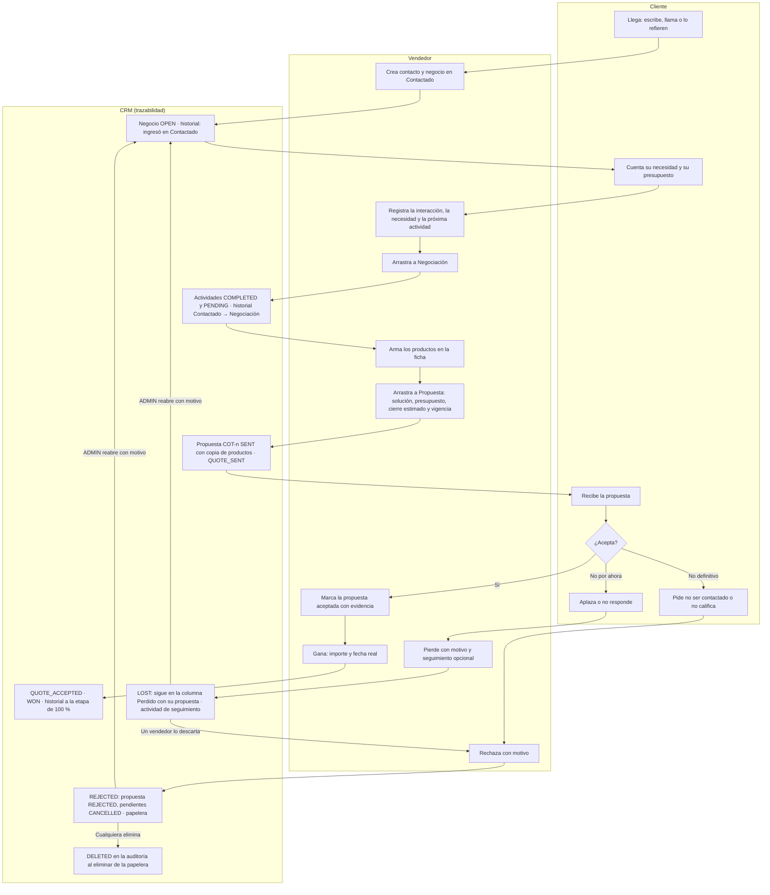

# Revisión del flujo comercial

**Responsable:** Zaith Manangón · **Estado:** Completo (12/12 criterios). Pedido del usuario del 2026-10-24, con las 8 observaciones del tester sobre el tablero y la ficha de negocio. Autoriza cambiar el módulo de pipeline y el tablero de Eduardo (CRM-17 a CRM-19), el API y las fichas de contactos y empresas (CRM-13 a CRM-15) y activar `relationJoins` en todo el API.

## Objetivo

Resolver las observaciones del tester sobre el recorrido de un negocio. Perdido y Rechazado pasan a ser dos cierres distintos, el modal de cambio de etapa deja de fallar a medias, la propuesta guarda sus productos y el cliente queda trazable de punta a punta. Se suman tiempos de respuesta medidos, un diagrama del flujo y pruebas de cada camino.

El pedido no trae criterios escritos; salen de las 8 observaciones y de las decisiones del usuario del 2026-10-25.

## Criterios de aceptación

- [x] **Perdido** es un cierre recuperable: sigue en su columna del tablero, conserva la propuesta y las actividades, usa sus propios motivos y ofrece un seguimiento opcional (por defecto, a 3 meses).
- [x] **Rechazado** invalida el proceso: usa sus propios motivos, la propuesta vigente queda *Rechazada*, las actividades pendientes, *Canceladas*, y el negocio sale del tablero hacia la papelera. Cualquier usuario puede rechazar un perdido.
- [x] La **papelera** (`/pipeline/papelera`) lista los rechazados, cualquier usuario elimina varios a la vez con confirmación y cada borrado queda auditado. Solo un ADMIN reabre, con motivo.
- [x] Cuando falta un dato para cambiar de etapa, el modal **recomienda completar la ficha** y enlaza a ella.
- [x] El modal **valida antes de guardar**: cada campo pendiente es obligatorio y tiene su propio mensaje, no se guarda nada a medias y no se ignora ninguna fecha.
- [x] Mover a Propuesta desde el tablero **no da error** con un negocio nuevo. Si la propuesta solo se puede registrar en la ficha (no hay productos), el modal guarda lo llenado y lleva allá con «Guardar e ir a la ficha».
- [x] **Cada propuesta guarda los productos** con los que se envió, y la ficha los muestra bajo la propuesta.
- [x] La línea de tiempo muestra los **eventos de cada propuesta**: enviada, aceptada, desactualizada y rechazada, con quién y cuándo.
- [x] Las fichas de contacto y empresa muestran el **recorrido de cada negocio**: etapa, estado, motivo del cierre y último movimiento.
- [x] **Tiempos de respuesta** medidos antes y después en los mismos pasos, con mejora en cada paso del recorrido.
- [x] **Diagrama del flujo**: qué hace el cliente, qué hace el vendedor y qué registra el CRM en cada etapa, más los estados del negocio con sus permisos.
- [x] **Pruebas** de cada camino: unitarias del API y de la web, integración contra `pruebas` y navegador con el recorrido del tester.

## Implementación

### Datos — migración `20261025120000_rejected_and_quote_items`

- `DealStatus` suma `REJECTED`.
- `LossReason` pasa a ser el motivo de cualquier cierre:
  - `PRICE` se renombra a `NEGOTIATION` («Problemas de negociación»).
  - Se suman 8 valores nuevos.
  - Las filas de `AuditLog` que guardaban `PRICE` se actualizan igual.
- `Quote.items` (`JSONB`, por defecto `[]`) guarda la copia de los productos.
- `packages/database/prisma/schema.prisma`: `previewFeatures = ["relationJoins"]`, los dos enums y `Quote.items`.
- `packages/database/prisma/migrations/20261025120000_rejected_and_quote_items/migration.sql`.
- `packages/shared/src/catalogos.ts`:
  - `DEAL_STATUSES` con `REJECTED`.
  - `CLOSE_REASONS` es el enum completo; `LOSS_REASONS` y `REJECTION_REASONS` son sus subconjuntos.
  - `TRANSITION_CHECKS` con `REJECTION_REASON`.

| Cierre | Motivos |
| --- | --- |
| Perdido (`LOSS_REASONS`) | Falta de presupuesto, Competencia, Falta de tiempo, Falta de respuesta, Necesidad aplazada, Problemas de negociación, Cambio de prioridades, Otro |
| Rechazado (`REJECTION_REASONS`) | Cliente rechaza definitivamente, Producto no adecuado, Cliente no cumple requisitos, Riesgo comercial, Solicitud fuera del alcance, Cliente solicita no ser contactado, Otro |

### API

- `apps/api/src/modules/pipeline/stage-gates.ts`: destino `rejected` y pendiente `REJECTION_REASON`.
- `apps/api/src/modules/pipeline/pipeline.service.ts`:
  - **Rechazar**, desde abierto o perdido, en una sola transacción:
    - `status = REJECTED`, con motivo, detalle y `closedAt`.
    - Las propuestas `SENT`/`ACCEPTED` pasan a `REJECTED`.
    - Las actividades `PENDING` pasan a `CANCELLED`.
    - Se escribe una fila `REJECTED` en `AuditLog`, con las propuestas rechazadas y la cantidad de actividades canceladas.
    - Un ganado responde `409` («Reabre el negocio antes de rechazarlo.»).
    - Un vendedor puede rechazar un perdido aunque no sea de su propiedad.
  - **Perder** con un seguimiento opcional, creado con el contacto, la empresa y el responsable del negocio.
  - **Propuestas**:
    - `createQuote` copia los productos en su orden y audita `QUOTE_SENT`.
    - `acceptQuote` audita `QUOTE_ACCEPTED`.
    - `saveItems` y `createQuote` auditan `QUOTE_SUPERSEDED` en cada propuesta que dejan desactualizada.
  - Con un negocio rechazado, `saveItems` y `createActivity` responden `409`.
  - **Tablero**:
    - Las etapas muestran los negocios `OPEN` y `WON`, y la columna Perdido muestra `LOST`.
    - `REJECTED` no aparece en el tablero; solo se cuenta en `metrics.rejected`.
  - `listDeals` filtra por `status`.
  - `deleteRejected(ids)`: borra solo rechazados y deja una fila `DELETED` por cada uno.
  - **Tiempos**:
    - `findDeal` y `previewTransition` se leen sin transacción.
    - `detail()` y `gateFacts()` hacen sus lecturas en paralelo.
    - `write()` traduce P2028 (tiempo límite de la transacción) a `503` «no se guardó nada».
- `apps/api/src/modules/pipeline/pipeline.dto.ts`:
  - `RejectDealDto`.
  - `LoseDealDto`, con `followUp { type, subject, dueAt }`.
  - `DeleteDealsDto`: de 1 a 100 ids, sin repetir.
  - `ListDealsDto.status`.
- `apps/api/src/modules/pipeline/pipeline.controller.ts`: `POST /deals/:id/reject` y `POST /deals/rejected/delete`.
- `apps/api/src/modules/pipeline/deal-rules.ts`: `dealMetrics` suma `rejected`.
- `apps/api/src/modules/contacts/contacts.service.ts` y `apps/api/src/modules/companies/companies.service.ts`: cada negocio de la ficha trae `closedAt`, `lossReason` y su último movimiento (`stageHistory`, `take: 1`).
- `apps/api/src/common/filters/global-exception.filter.ts`: registra con `Logger.error` todo error 500. Antes no dejaba rastro.

### Endpoints nuevos

| Método y ruta | Quién | Respuesta |
| --- | --- | --- |
| `POST /deals/:id/reject` `{ lossReason, lossDetail?, fromStageId? }` | Cualquiera (un ganado se reabre antes) | El negocio en `REJECTED` |
| `POST /deals/:id/lose` `{ …, followUp? { type, subject, dueAt } }` | Igual que antes | El negocio en `LOST` y, si se pidió, la actividad de seguimiento |
| `GET /deals?status=REJECTED&pipelineId=` | Cualquiera | Lista paginada (la usa la papelera) |
| `POST /deals/rejected/delete` `{ ids }` | Cualquiera | `{ deleted }`; `409` si algún id no es un rechazado |

### Web

- **Modal de cambio de etapa** (`apps/web/features/pipeline/transition-dialog.tsx` y `actions.ts`):
  - **Recomendación** con el enlace *Abrir la ficha*.
  - `transitionError()` valida cada campo antes de guardar.
  - `saveTransitionAction()` guarda sin mover, para «Guardar e ir a la ficha».
  - Motivos de pérdida con un **seguimiento opcional**.
  - Motivos de rechazo con el aviso «Se invalidará el proceso…».
- **Tablero** (`features/pipeline/pipeline-board.tsx`):
  - Zona **Rechazado** con la cantidad y *Ver papelera*.
  - «Rechazado» en el selector de la tarjeta.
  - Sin `router.refresh()`: la server action ya revalida.
- **Papelera**:
  - Archivos: `apps/web/app/(dashboard)/pipeline/papelera/{page,loading,page.test}.tsx` y `features/pipeline/rejected-trash.tsx`.
  - Tabla con casillas, *Seleccionar todos*, *Eliminar seleccionados (n)* con confirmación y *Reabrir* (solo ADMIN).
- **Ficha** (`app/(dashboard)/pipeline/[id]/page.tsx`, `deal-actions.tsx`, `deal-quotes.tsx`, `deal-timeline.tsx`, `deal-items.tsx`, `activity-actions.tsx`, `deal-qualification.tsx`):
  - *Rechazar* para negocios abiertos y perdidos.
  - Tarjeta *Cierre* del rechazado.
  - Productos de cada propuesta en un `
`.
  - Eventos de propuestas en la línea de tiempo.
  - Productos y actividades bloqueados mientras el negocio está rechazado.
- **Recorrido del cliente**: `features/pipeline/deal-journey.tsx`, usado en `app/(dashboard)/contactos/[id]/page.tsx` y `app/(dashboard)/empresas/[id]/page.tsx`.
- **Tablero en paralelo**: `app/(dashboard)/pipeline/page.tsx` pide las opciones y el tablero con `Promise.all`.
- **Textos, tipos y estilos**:
  - `content/catalogos.ts`: `ESTADO_NEGOCIO.REJECTED`; `MOTIVO_PERDIDA` pasa a `MOTIVO_CIERRE`.
  - `content/pipeline.ts`: `TABLERO`, `TRANSICION`, `PAPELERA`, `RECORRIDO` y la línea de tiempo.
  - `features/pipeline/types.ts` y los `types.ts` de contactos y empresas.
  - `components/ui/badge.tsx`: tono `danger`.
  - `styles/05-superficies.css` y `styles/pipeline.css`.
  - `docs/design/TOKENS.md`: sección *Estados del negocio y papelera*.

### Pruebas

- **API unitarias** (`apps/api/test/unitarias/`):
  - `pipeline/{pipeline.service,pipeline.dto,stage-gates,deal-rules,pipeline-config.service}.test.cjs`.
  - `contacts/contacts.service.test.cjs`, `companies/companies.service.test.cjs` y `app.setup.test.cjs`.
- **Integración**: `apps/api/test/integracion/pipeline.http.test.cjs`.
- **Web**: `*.test.tsx` junto a cada archivo, más `rejected-trash.test.tsx`, `deal-journey.test.tsx` y `papelera/page.test.tsx`, que son nuevos.
- **Navegador**: `test/e2e/pipeline.spec.ts`, con el recorrido del tester y el flujo Perdido → Rechazado → papelera.

## Diagrama del flujo comercial

Versión para el equipo y el tester, con los requisitos de cada etapa y los motivos de cierre: [Flujo comercial Wave](https://claude.ai/artifact/KCdC8N1XZ2wDZU44exVeEe) (privada; se comparte desde su menú *Share*).

### Recorrido del cliente

Qué hace el cliente, qué hace el vendedor y qué deja registrado el CRM en cada etapa del pipeline predeterminado. Los requisitos de cada etapa vienen del seed y un ADMIN los cambia en *Configurar pipeline*.

Se puede perder o rechazar desde cualquier etapa abierta, no solo después de la propuesta. Retroceder de etapa exige motivo y no borra datos. La ficha del contacto y la de la empresa muestran el recorrido de cada negocio.

### Estados del negocio

```mermaid
stateDiagram-v2
  [*] --> Abierto: crear negocio (cualquiera)
  Abierto --> Abierto: mover de etapa\n(requisitos de entrada; retroceder exige motivo)
  Abierto --> Ganado: propuesta aceptada con evidencia,\nimporte = productos, fecha real
  Abierto --> Perdido: motivo de pérdida\n(+ seguimiento opcional)
  Abierto --> Rechazado: motivo de rechazo
  Perdido --> Rechazado: motivo de rechazo (cualquiera)
  Perdido --> Abierto: reabrir (solo ADMIN, motivo)
  Ganado --> Abierto: reabrir (solo ADMIN, motivo)
  Rechazado --> Abierto: reabrir (solo ADMIN, motivo)
  Rechazado --> [*]: eliminar desde la papelera\n(cualquiera, confirmación, auditado)
```

| Estado | Dónde se ve | Propuesta | Actividades | Quién lo cambia |
| --- | --- | --- | --- | --- |
| Abierto | Columna de su etapa | Enviada o aceptada | Abiertas | Su responsable o un ADMIN |
| Ganado | Etapa de 100 % | Aceptada | Se conservan | Solo un ADMIN (reabrir) |
| Perdido | Columna Perdido | Se conserva *Enviada* | Se conservan, más el seguimiento | Cualquiera lo rechaza; solo un ADMIN lo reabre |
| Rechazado | Papelera | *Rechazada* | Pendientes *Canceladas* | Cualquiera lo elimina; solo un ADMIN lo reabre |

## Decisiones

- **Un solo enum para los dos cierres.** `LossReason` y `Deal.lossReason` guardan el motivo del perdido o del rechazado, y `@wave/shared` separa los dos subconjuntos que validan el DTO y el modal.
  - Renombrar la columna o el tipo tocaría el código de CRM-18 y CRM-21 sin ganar nada.
  - `PRICE` pasa a `NEGOTIATION` con `RENAME VALUE`: los negocios que ya lo tenían conservan su motivo.
- **Migración escrita a mano.** Prisma generaría `DROP`/`CREATE` del enum, que falla con filas existentes. Se hace `ADD VALUE`, como en `stage_gates`.
- **Copia de productos en `Quote.items` (JSON) en vez de una tabla `QuoteItem`.** La propuesta es una foto de un momento, nadie la consulta por producto, y una columna evita un modelo, su migración y su relación.
  - Las propuestas anteriores muestran «Registrada sin detalle de productos».
- **Rechazar no escribe una fila `QUOTE_REJECTED` aparte.** La fila `REJECTED` ya guarda las propuestas rechazadas y la cantidad de actividades canceladas, y la línea de tiempo lo resume («1 propuesta rechazada · 1 actividad cancelada»).
- **Borrado real desde la papelera, con auditoría.** `deleteRejected` responde `409` si algún id no está rechazado, para que nunca se borre un negocio vivo.
  - Cada borrado deja una fila `DELETED` con título, motivo, contacto, empresa y valor, porque el negocio ya no existe para consultarlo.
- **La papelera no filtra por pipeline** y muestra 20 por página. La zona Rechazado del tablero solo recibe tarjetas y no las lista, para no repetir la papelera.
- **«Guardar e ir a la ficha».** Cuando un pendiente solo se completa en la ficha (productos para la propuesta, aceptación o importe final), el modal ya no intenta mover. Antes guardaba lo llenado, el `move` respondía `422` y el pendiente concreto solo se veía en Network: era el error del punto 4.
- **Validar antes de guardar.** El formulario solo contiene los campos de lo que falta, así que cada uno es obligatorio. Antes, un asunto vacío hacía que se ignorara su fecha sin avisar.
- **Tiempos.** Desde Ecuador, cada ida y vuelta a Neon (us-east-2) cuesta unos 130 ms, y Prisma hacía una consulta por relación. Cambios:
  - `relationJoins` (activado para todo el API, con OK del usuario): la ficha pasa de 14 consultas a 2.
  - Sin el `router.refresh()` que repintaba el tablero dos veces.
  - Opciones y tablero en paralelo.
  - Lecturas sin transacción.
  - P2028 traducido a `503`.
- **Lo que queda del tiempo de mover.** Mover con el modal todavía encadena 3 o 4 llamadas HTTP: la del negocio, las actividades, la propuesta y el `move`, cada una en su transacción.
  - No se paralelizan, porque escriben sobre el mismo negocio.
  - Si hace falta bajar más, el siguiente paso es un endpoint de transición que lo guarde todo en una transacción (ver *Pendientes*).
- **Coordinación con CRM-13 a CRM-15 y CRM-17 a CRM-21.** Con OK del usuario se cambiaron:
  - el módulo de pipeline y el tablero de Eduardo;
  - el `include` de las fichas de contactos y empresas;
  - el filtro global de excepciones, un módulo compartido.

  Los bloques fechados de cada ticket lo registran.

## Validación

### Tiempos (mismo recorrido, `next dev` + `nest --watch` contra `pruebas`)

| Paso | Antes (ms) | Después (ms) |
| --- | ---: | ---: |
| Cargar el tablero | 5666 | 2453 |
| Crear el negocio | 8750 | 4143 |
| Abrir el modal de Negociación | 5716 | 1593 |
| Guardar y mover a Negociación | 11094 | 9261 |
| Abrir el modal de Propuesta | 5115 | 1593 |
| Propuesta sin productos | 9117 (`422`, error) | 4363 (guarda y abre la ficha) |
| Cargar la ficha | 7824 | 2415 |
| Guardar productos | 6046 | 2992 |
| Mover a Propuesta con la propuesta | 9001 | 8441 |
| Ganar | — | 6041 |

- Antes: código `e499a9a`. Después: los tiempos que imprime la e2e *recorrido del tester*.
- Los modales del antes incluyen la vista previa doble de React StrictMode en desarrollo.
- En producción (Render en Virginia, a pocos milisegundos de Neon) cada consulta cuesta una fracción de esto.

### Pruebas

Verificación final del 2026-10-26, con `pnpm dev` apagado:

| Comando | Resultado |
| --- | --- |
| `pnpm lint` | Sin errores |
| `pnpm test` | API: 230 de 230. Web: 328 de 328 en 79 archivos |
| `pnpm build` | Sin errores (incluye la ruta nueva `/pipeline/papelera`) |
| `pnpm test:integration` (rama `pruebas`) | 54 de 54 en todos los archivos, incluidas las nuevas de `pipeline.http.test.cjs`: propuesta con copia de productos y sus eventos; perder con seguimiento → rechazar como vendedor → `?status=REJECTED` → borrado múltiple; reabrir un rechazado como ADMIN |
| `pnpm test:e2e` (rama `pruebas`) | 28 de 28, incluidas las dos nuevas: *recorrido del tester* (Contactado → Negociación → Propuesta sin productos → ficha → Propuesta → Ganado, sin respuestas `5xx`) y *perdido con seguimiento → rechazado → la papelera elimina dos a la vez* |

- La segunda pasada de la e2e del recorrido repitió los tiempos de la tabla con ±0,5 s (ganar: 7,1 s).
- La migración `20261025120000_rejected_and_quote_items` está aplicada solo en `pruebas`; pasa a `development` con OK del usuario.

## Quality Gate y precarga de estilos del pipeline (2026-10-26)

### Implementación

- `apps/web/features/pipeline/transition-dialog.tsx`: la función `async` del `useEffect` que abre el modal se ejecuta como `void (async () => { … })()`.
- `apps/web/app/(dashboard)/pipeline/layout.tsx` (nuevo): importa `styles/pipeline.css` una sola vez para el tablero, la ficha, la papelera y el esqueleto.
- `apps/web/app/(dashboard)/pipeline/loading.tsx`, `page.tsx`, `[id]/page.tsx` y `papelera/page.tsx`: ya no importan la hoja.

### Decisiones

- **Quality Gate.** El push `18c1a92` falló en CI solo en SonarCloud: fiabilidad del código nuevo C (máximo A) por una incidencia, `typescript:S9383` (promesa sin `await`, `.catch` ni `void`) en el modal de transición. El efecto ya ignora el resultado si el modal se cerró, así que basta con `void`.
- **Precarga de estilos.** Con la hoja importada en `loading.tsx`, Next le daba al esqueleto un chunk CSS propio. En cada `router.refresh()` o acción de servidor, Next precarga los chunks `layout`, `page` y `loading`, pero el del esqueleto nunca llega a aplicarse, y Chrome avisaba "preloaded using link preload but not used" una vez por respuesta (en desarrollo el `?v=` cambia cada vez). Con el layout de segmento, la hoja vive en un único chunk que siempre se aplica.
- **Coordinación con CRM-17 a CRM-19.** El layout nuevo queda en `app/(dashboard)/pipeline/`, la carpeta del tablero de Eduardo: los estilos de una pantalla nueva del pipeline ya no se importan en la página.

### Validación

- `pnpm lint` sin errores; `tsc --noEmit` de la web sin errores; 132 de 132 pruebas web de `app/(dashboard)` y `features/pipeline`.
- `pnpm build` sin errores. `prisma generate` no corrió porque el API de desarrollo bloqueaba el motor en Windows; el esquema no cambió y se compilaron `@wave/database` (`tsc`), el API y la web por separado.
- En el navegador (`/pipeline`, `next dev`), después de `router.refresh()` todos los `preload` de estilos tienen su `stylesheet` y el chunk `pipeline/loading.css` ya no existe. El tablero conserva sus estilos.

## Sanitización de los formularios del pipeline (2026-10-27)

### Implementación

- `packages/shared/src/text.ts` (nuevo) y `index.ts`: `cleanText(valor, multilinea?)`. Compone Unicode (NFC), quita controles C0/C1 (el nulo `\0` incluido), invisibles (guion blando, ancho cero, BOM), marcas de dirección (bidi), etiquetas U+E0000 y sustitutos sueltos; recorta y junta los espacios. Con `multilinea` conserva los saltos de línea (CRLF pasa a LF, hasta una línea en blanco seguida).
- `apps/api/src/modules/pipeline/pipeline.dto.ts`: `text()` usa `cleanText` (4.º parámetro `multiline` para necesidad, solución, justificación del presupuesto, motivos, detalle del cierre, nota de actividad y evidencia de aceptación). `numeric()` solo convierte a número lo escrito en cifras (`/^-?\d+(\.\d+)?$/`). En los campos numéricos `IsNumber`/`IsInt` pasan al final de la lista: class-validator informa primero el decorador listado al final y un texto como «1e3» mostraba el mensaje de `@Max`; `value` y `position` además tenían ese mensaje en inglés.
- `apps/web/features/pipeline/actions.ts`: `formText` usa `cleanText` (conjunto `MULTILINE` con los mismos campos de varias líneas); `saveDeal` lo reutiliza en vez de su propio `trim()`; `saveDealItemsAction` limpia cada celda de las filas (llegan como argumento, no como `FormData`) y trata como vacío lo que no es texto.
- Pruebas: `apps/api/test/unitarias/common/text.test.cjs` (nuevo), dos casos en `pipeline.dto.test.cjs` y dos en `features/pipeline/actions.test.ts`.

### Decisiones

- **Un solo punto por lado.** Todo texto del pipeline entra por `formText` (web) o por `text()` (API); no se tocó cada componente. La web limpia para mostrar los errores con el valor real y el API vuelve a limpiar porque es el borde de confianza (otro cliente puede llamarlo sin la web).
- **El HTML no se elimina.** React escapa al pintar, Prisma parametriza y no hay `dangerouslySetInnerHTML`; quitar «<» dañaría textos como «Oferta < 5 mil». Si algún día un dato del pipeline se inserta en un correo o un CSV, se escapa allí (como ya hace `mailer.service.ts`).
- **Montos y fechas** ya eran estrictos (expresión regular y calendario real); lo nuevo es que el API tampoco acepta notación científica ni hexadecimal.
- Los ids (`pipelineId`, `stageId`, …) pasan por `text()` y viajan con `encodeURIComponent`; las listas de ids de la papelera y los parámetros de la URL (`pipelineId`, `page`) ya se validaban.

### Validación

- API 236 de 236 (`pnpm --filter @wave/api test`); web `features/pipeline` y `app/(dashboard)/pipeline`, 110 de 110.
- `pnpm lint` y `pnpm build` sin errores.

## Pendientes

- Endpoint único de transición (datos del modal más el cambio de etapa en una transacción), si mover con el modal sigue lento en producción.
- Recordatorio automático del seguimiento de un perdido: aún no hay módulo de actividades que lo dispare.
- Documento imprimible o PDF de la propuesta: no se eligió en este pedido.
