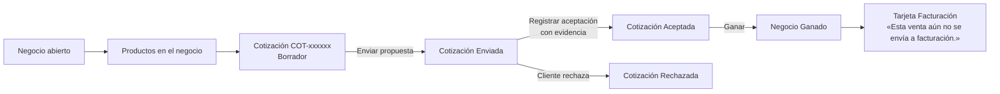
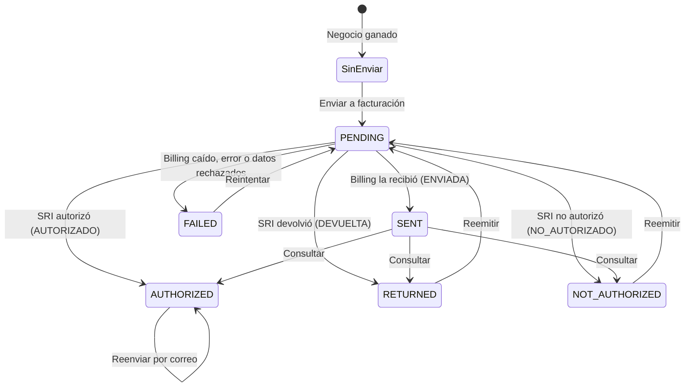

# Flujos de Wave Billing (CRM-31)

Guía de cómo una venta del CRM llega a convertirse en factura en Wave Billing. El detalle técnico está en `31 - Puente a Wave Billing.md`.

## Lo que hay que recordar

1. **Ganar no factura.** Ganar solo cierra el negocio. El envío a Billing es **manual**: botón *Enviar a facturación* en la tarjeta *Facturación* (pestaña *Resumen* del negocio ganado).
2. **Los abonos no van a Billing.** *Pagos* (`DealPayment`) es un registro interno del CRM. El puente no lee ni envía abonos; a Billing solo va la factura de la cotización aceptada.
3. **Se factura la cotización aceptada**, no los productos del negocio. `ventaId` = id de esa cotización, por eso un doble clic o un reintento no duplican la factura.
4. **El CRM no firma ni emite.** Billing firma y manda al SRI; el CRM guarda el estado y el historial.

## 1. Del negocio a la venta ganada



Para **ganar** el negocio exige (`stage-gates.ts`):

| Requisito | Mensaje si falta |
| --- | --- |
| Requisitos de todas las etapas abiertas (menos próxima actividad) | El de cada etapa |
| Viable con evidencia | Marca el negocio como viable y registra la evidencia |
| Cotización **Aceptada** | Registra la aceptación de la propuesta con su evidencia |
| Total de la cotización = total de los productos | El importe de la propuesta aceptada no coincide… Registra y acepta una nueva |
| Fecha real de cierre, no futura | Ingresa la fecha real de cierre |
| Pago confirmado (casilla) | Confirma que se comprobó el pago |

> La casilla *pago confirmado* de ganar tampoco se envía a Billing: solo es un requisito para cerrar.

### Otros cierres (nunca llegan a Billing)

| Cierre | Qué pasa | ¿Billing? |
| --- | --- | --- |
| **Perdido** | Exige motivo, sigue en el tablero y se puede recuperar | No |
| **Rechazado** | Exige motivo, invalida propuesta y pendientes, va a la papelera | No |
| **Reabrir** un ganado | Vuelve a abierto | Bloqueado si hay factura en camino (ver §4) |

## 2. Emisión de la factura

```mermaid
sequenceDiagram
  actor U as Usuario
  participant W as Web (tarjeta Facturación)
  participant A as API CRM
  participant B as Wave Billing
  participant S as SRI
  U->>W: Enviar a facturación (comprador + forma de pago)
  W->>A: POST /deals/:id/billing
  A->>A: ¿Ganado y con cotización aceptada? ¿Ya entregada?
  A->>A: Fila BillingHandoff = PENDING
  A->>B: POST /api/v1/facturas (ventaId = id cotización, máx. 20 s)
  B->>S: Firma y envía
  B-->>A: estado + clave de acceso + secuencial
  A->>A: Guarda estado, mensajes, intentos; historial BILLING_SENT
  A-->>W: Factura 001-001-00000000N y su estado
```

En el diálogo se elige:

- **Facturar a:** empresa con RUC o contacto. Si ambos tienen RUC, eliges; si solo uno, ese; si ninguno, el contacto con cédula o pasaporte. Nunca Consumidor Final. Sin ninguno: «No hay a quién facturar».
- **Forma de pago:** Transferencia (`20`, por defecto), Efectivo (`01`), Débito (`16`), Crédito (`19`).
- **IVA de cada línea:** 15, 8, 5 o 0. Otra tarifa bloquea el envío.

## 3. Estados de la factura y qué botón aparece



| Estado (CRM) | Qué significa | Botones en la tarjeta |
| --- | --- | --- |
| *(sin fila)* | Ganado pero nunca enviado | **Enviar a facturación** |
| `PENDING` | Se está enviando (si pasa de 2 min, se puede retomar) | **Reintentar** |
| `SENT` | Billing la tiene, el SRI aún no responde | **Consultar**, PDF, XML |
| `AUTHORIZED` | Factura válida con número de autorización | **Reenviar por correo**, PDF, XML |
| `RETURNED` | El SRI la devolvió (ej. RUC no registrado) | **Reemitir**, PDF, XML, mensajes del SRI |
| `NOT_AUTHORIZED` | El SRI la rechazó | **Reemitir**, PDF, XML, mensajes del SRI |
| `FAILED` | Billing no respondió o rechazó los datos | **Reintentar** y el mensaje |

### Casos

- **Aceptada:** Enviar → `SENT` o directo `AUTHORIZED`. Si queda `SENT`, *Consultar* hasta `AUTHORIZED`. Luego se puede reenviar por correo y ver el RIDE.
- **Devuelta / no autorizada por el SRI:** se leen los mensajes del SRI, se corrigen los datos del cliente (RUC, nombre, correo) en su ficha y se pulsa **Reemitir**: Billing usa los datos actuales del cliente.
- **Datos rechazados por Billing** (4xx): `FAILED` con el mensaje de Billing. Se corrige y se pulsa **Reintentar**.
- **Billing caído o más de 20 s** (5xx o sin red): `FAILED` con «Wave Billing no respondió». La factura *pudo* emitirse; **Reintentar** usa el mismo `ventaId`, así que Billing devuelve la existente en vez de crear otra.
- **Doble clic o reintento de una ya entregada:** el API devuelve la entrega guardada y no llama a Billing.
- **Reemisión sin respuesta:** queda `FAILED`; **Consultar** reconcilia con lo que tenga Billing.
- **Si cambian los productos** después de facturar: nueva cotización. La factura emitida no cambia.

## 4. Qué bloquea una venta facturada

| Estado de la entrega | ¿Reversar, mover de etapa, eliminar o vaciar papelera? |
| --- | --- |
| `PENDING`, `SENT`, `AUTHORIZED` | **Bloqueado** |
| `FAILED` porque Billing no respondió | **Bloqueado** (la factura pudo emitirse; *Reintentar* lo aclara) |
| `RETURNED`, `NOT_AUTHORIZED`, otro `FAILED` | Permitido (no hay factura válida) |

Anular una factura autorizada (nota de crédito) se hace en Billing, no en el CRM.

## 5. Checklist si «no se refleja en Billing»

1. ¿El negocio está **Ganado**? La tarjeta *Facturación* solo aparece en el *Resumen* de un ganado.
2. ¿Pulsaste **Enviar a facturación**? Sin ese clic no se llama a Billing.
3. ¿La tarjeta dice «No hay a quién facturar»? Falta empresa con RUC o contacto con documento.
4. ¿Error «Wave Billing no está configurado»? Faltan variables `WAVE_BILLING_*` en el `.env` con el que arrancó el API.
5. ¿Quedó `FAILED` o `RETURNED`? Lee el mensaje en la tarjeta y en el historial (*Enviada a facturación*, *No se pudo enviar a facturación*, *Factura: …*).
6. ¿Buscas en Billing el **emisor y ambiente** correctos? El CRM envía al emisor, sucursal, punto de emisión y ambiente del `.env` (`1` = pruebas del SRI).
7. ¿Registraste un **abono**? No viaja a Billing: es solo del CRM.
